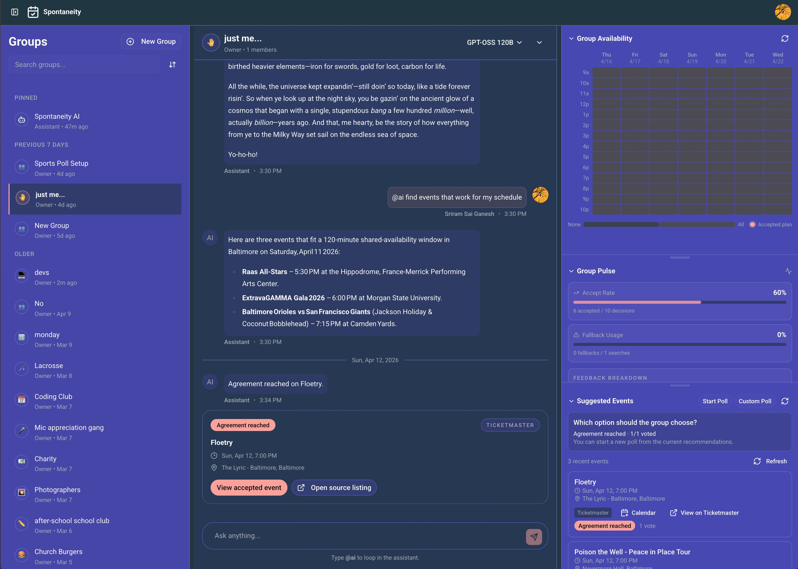

# Spontaneity

### `Plan real outings fast! 📍⚡`



Spontaneity can automatically:

- Find events in your area
- Match schedules between friends
- Consider user preferences, and
- Create a plan for the group
  All in one place!

## Project Description

Spontaneity is an **AI-powered social planning system** that automatically analyses users preferences (event type, geographic location, event time) and agentically finds suitable activities to recommend.

Users create a friend group, connect their calendars, and enter preferences such as cuisines, hobbies, time, and budget.

The system **curates events** in a geographic area, identifies **optimal meeting times** and **generates activity suggestions**, eliminating the hassle of finding an event and schedule that everyone will enjoy.

Spontaneity **removes the stress of coordination** and makes it easier for users to plan social activities together.

### Tech Stack

Spontaneity is currently implemented as an authenticated AI chat app built with React + Convex.

- Frontend: React 19, TypeScript, Vite, Wouter, Tailwind CSS v4, Radix UI, Legend-State
- Backend: Convex functions + Convex HTTP action + Hono
- AI: Vercel AI SDK + OpenRouter provider
- Auth: `@convex-dev/auth` (Google + Anonymous providers configured)
- Testing: Vitest, Testing Library, Playwright

### Architecture Overview

1. User sends a message in the React app.
2. Frontend persists the user message via Convex mutation.
3. Frontend calls `POST /api/chat` on the Convex site URL with Bearer auth.
4. Convex HTTP action validates auth and ownership, then streams model output via SSE.
5. During generation, tool calls/results (weather) are emitted as SSE events.
6. Assistant message is incrementally flushed to DB and marked complete at the end.

### Prerequisites

- Node.js 20+
- `pnpm`
- Convex account/CLI access (`npx convex ...`)
- OpenRouter API key

### Setup

1. Install dependencies:

```bash
pnpm install
```

2. Start Convex dev:

```bash
npx convex dev
```

3. Configure required Convex environment variables for backend chat streaming:

```bash
npx convex env set OPENROUTER_API_KEY <your_openrouter_key>
npx convex env set VITE_CONVEX_URL https://kindly-cuttlefish-473.convex.cloud
```

4. Run the app (frontend + backend concurrently):

```bash
pnpm dev
```

### Available Scripts

- `pnpm dev` - run Convex dev + Vite dev together
- `pnpm dev:backend` - Convex dev only
- `pnpm dev:frontend` - Vite dev only
- `pnpm build` - production frontend build
- `pnpm preview` - preview built frontend
- `pnpm lint` - ESLint with `--fix`
- `pnpm format` - Prettier write
- `pnpm type-check` - frontend + Convex TypeScript checks
- `pnpm validate` - type-check + lint + tests

### Testing

- `pnpm test` - run all Vitest projects
- `pnpm test:frontend` - frontend tests only
- `pnpm test:convex` - Convex tests only
- `pnpm test:team` - Iteration 2 team-wide test flow
- `pnpm test:coverage` - coverage run
- `pnpm test:e2e` - Playwright end-to-end tests (see below)

### End-to-End Tests (Playwright)

The E2E suite (`e2e/`) covers group creation, recommendation rendering, poll-based plan acceptance with RSVP follow-through, profile settings, and theme selection. Tests run against the **real Convex backend and live event APIs** (Ticketmaster, Yelp, Google Places). See [#311](https://github.com/jhu-oose-f24/team-05/issues/311) for the tracking issue.

**Prerequisites:**

- Convex backend configured and deployable (`npx convex dev` succeeds)
- `.env.local` with `VITE_CONVEX_URL` pointing to your Convex deployment
- API keys set in the Convex dashboard (Ticketmaster, Yelp, Google Places, OpenRouter)
- Playwright browsers installed: `npx playwright install chromium`

**Running:**

```bash
pnpm test:e2e              # runs all E2E specs (~2-3 min)
pnpm test:e2e -- --ui      # interactive Playwright UI mode
```

The Playwright config starts both the Convex backend and Vite frontend automatically. If you already have `pnpm dev` running, set `PLAYWRIGHT_REUSE_SERVER=1` to skip the server launch:

```bash
PLAYWRIGHT_REUSE_SERVER=1 pnpm test:e2e
```

**Strict mode:** By default, recommendation/poll tests soft-pass when the APIs return 0 events (e.g., transient API issues). To require real results:

```bash
E2E_REQUIRE_REAL_RECOMMENDATIONS=1 pnpm test:e2e
```

**Spec files:**

| File | Coverage |
|------|----------|
| `seed.spec.ts` | Clean-state app load |
| `group-flow.spec.ts` | Create, edit, delete, search groups |
| `profile.spec.ts` | Profile / nickname settings |
| `theme.spec.ts` | Theme dialog, persistence, system preference |
| `recommendations.spec.ts` | Right-panel and chat Find Events flows |
| `accepted-plan.spec.ts` | Poll vote → close → RSVP follow-through |

### Key Directories

- `src/` - React app (chats, messages, settings, layout, UI)
- `convex/` - schema, queries/mutations/actions, HTTP chat streaming
- `e2e/` - Playwright end-to-end tests
- `docs/` - planning/product/team docs
  - `docs/iteration-x-plan.md` - iteration plans
  - `docs/product-requirements.md` - product requirements document
  - `docs/team-agreement.md` - team agreement and roles
- `manuals/` - end-user guides and screenshots
